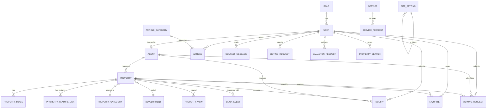

# Architecture Documentation

**Last Updated:** October 19, 2026

---

## Table of Contents
1. [System Architecture](#system-architecture)
2. [Backend Architecture](#backend-architecture)
3. [Frontend Architecture](#frontend-architecture)
4. [Database Architecture](#database-architecture)
5. [Authentication Architecture](#authentication-architecture)
6. [API Design Patterns](#api-design-patterns)
7. [State Management](#state-management)
8. [Component Architecture](#component-architecture)
9. [Security Architecture](#security-architecture)
10. [Performance Considerations](#performance-considerations)

---

## System Architecture

### High-Level Architecture

```
┌─────────────────────────────────────────────────────────────┐
│                         Client Layer                         │
│  ┌──────────────┐  ┌──────────────┐  ┌──────────────┐     │
│  │ Public Users │  │   Staff      │  │    Admin     │     │
│  │  (Browser)   │  │  (Browser)   │  │  (Browser)   │     │
│  └──────┬───────┘  └──────┬───────┘  └──────┬───────┘     │
└─────────┼──────────────────┼──────────────────┼─────────────┘
          │                  │                  │
          └──────────────────┼──────────────────┘
                             │
                    ┌────────▼────────┐
                    │  Next.js 15     │
                    │  Frontend       │
                    │  (App Router)   │
                    └────────┬────────┘
                             │ HTTP/REST
                    ┌────────▼────────┐
                    │  Express.js     │
                    │  Backend API    │
                    │  (TypeScript)   │
                    └────────┬────────┘
                             │
                    ┌────────▼────────┐
                    │  TypeORM       │
                    │  (PostgreSQL)  │
                    └────────┬────────┘
                             │
                    ┌────────▼────────┐
                    │  PostgreSQL     │
                    │  (Neon Cloud)  │
                    └─────────────────┘
```

### Architecture Pattern
- **Pattern:** Monolithic with separated frontend/backend
- **Communication:** REST API over HTTP
- **Authentication:** JWT (stateless)
- **Database:** Relational (PostgreSQL) with ORM
- **Deployment:** Manual (no containerization currently)

---

## Backend Architecture

### Technology Stack
- **Runtime:** Node.js
- **Framework:** Express.js 4.21.2
- **Language:** TypeScript 5.7.2
- **ORM:** TypeORM 1.1.1
- **Database Driver:** pg (PostgreSQL) 8.23.1

### Directory Structure

```
backend/src/
├── app.ts                    # Express app configuration
├── server.ts                 # Server entry point
├── data-source.ts            # TypeORM data source export
├── controllers/              # Request handlers (33 files)
│   ├── adminController.ts
│   ├── adminPropertyController.ts
│   ├── agentController.ts
│   ├── authController.ts
│   ├── propertyController.ts
│   └── ...
├── entities/                 # TypeORM entities (28 files)
│   ├── User.ts
│   ├── Role.ts
│   ├── Property.ts
│   ├── Agent.ts
│   └── ...
├── routes/                   # Express route definitions (45 files)
│   ├── index.ts              # Route aggregator
│   ├── authRoutes.ts
│   ├── adminRoutes.ts
│   ├── propertyRoutes.ts
│   └── ...
├── middleware/               # Express middleware
│   ├── auth.ts               # JWT authentication
│   ├── authorize.ts          # Role-based authorization
│   ├── propertyManagerOwnership.ts  # Property ownership checks
│   ├── errorHandler.ts       # Global error handler
│   └── validation.ts         # Request validation
├── lib/                      # Utilities and configuration
│   ├── typeorm.ts            # TypeORM DataSource
│   ├── TextIdSubscriber.ts   # Auto-generate text IDs
│   └── passwordResetEmail.ts # Email utilities
├── config/                   # Configuration
│   ├── database.ts           # Database configuration
│   └── env.ts                # Environment variables
├── migrations/               # Database migrations (9 files)
│   ├── 20261002000001-ResetDatabaseSchema.ts
│   ├── 20261007000001-AddPasswordResetFields.ts
│   └── ...
├── scripts/                  # Utility scripts
│   ├── runMigrations.ts      # Migration runner
│   └── seedAdmin.ts          # Admin seeding
├── services/                 # (Empty - business logic in controllers)
├── types/                    # (Empty - types inline)
├── seed.ts                   # Database seeding
└── fix-schema.ts             # Schema fix script
```

### Request Flow

```
┌─────────────┐
│   Client    │
└──────┬──────┘
       │ HTTP Request
       ▼
┌─────────────┐
│  Express    │
│  Middleware │
└──────┬──────┘
       │
       ├─► CORS
       ├─► JSON Parser
       ├─► requireAuth (if protected)
       ├─► authorize (if role-based)
       └─► propertyManagerOwnership (if PM)
       │
       ▼
┌─────────────┐
│   Router    │
└──────┬──────┘
       │
       ▼
┌─────────────┐
│ Controller  │
└──────┬──────┘
       │
       ├─► Validate input
       ├─► Business logic
       ├─► TypeORM operations
       └─► Response formatting
       │
       ▼
┌─────────────┐
│  Response   │
└─────────────┘
```

### Middleware Stack

**Middleware Execution Order:**
1. `cors()` - CORS headers
2. `express.json()` - JSON body parsing
3. `requireAuth` - JWT verification (for protected routes)
4. `authorize(...roles)` - Role-based authorization (for role-restricted routes)
5. `propertyManagerOwnership` - Property ownership checks (for PM routes)
6. Route handler
7. `errorHandler` - Global error handling

### Controller Pattern

Controllers follow a consistent pattern:

```typescript
export const controllerAction = async (req: Request, res: Response, next: NextFunction) => {
  try {
    // 1. Extract and validate input
    const { param1, param2 } = req.body;
    
    // 2. Business logic
    const repository = AppDataSource.getRepository(Entity);
    const result = await repository.findOne({ where: { id } });
    
    // 3. Return response
    return res.json({ success: true, data: result });
  } catch (error) {
    // 4. Error handling
    return next(error);
  }
};
```

### TypeORM Configuration

**DataSource Setup:**
```typescript
export const AppDataSource = new DataSource({
  type: 'postgres',
  url: databaseUrl,
  synchronize: false,  // Use migrations only
  logging: databaseConfig.logging,
  entities: [/* 28 entities */],
  migrations: ['src/migrations/**/*.ts'],
  subscribers: [TextIdSubscriber],
});
```

**Text ID Subscriber:**
- Automatically generates UUID for text primary columns
- Triggers before entity insertion
- Ensures all entities have unique text IDs

---

## Frontend Architecture

### Technology Stack
- **Framework:** Next.js 15.0.0 (App Router)
- **Language:** TypeScript 6.0.3
- **Styling:** Tailwind CSS 3.4.19
- **State Management:** React Context (AuthContext)
- **HTTP Client:** Native fetch with custom API service layer
- **Icons:** Lucide React 1.46.0
- **Charts:** ApexCharts 8.1.0

### Directory Structure

```
frontend/
├── app/                      # Next.js App Router
│   ├── layout.tsx           # Root layout
│   ├── page.tsx             # Homepage
│   ├── globals.css          # Global styles
│   ├── admin/               # Admin dashboard routes
│   │   ├── dashboard/
│   │   ├── users/
│   │   ├── properties/
│   │   └── ...
│   ├── portal/              # Staff portal routes
│   │   ├── login/
│   │   ├── dashboard/
│   │   ├── forgot-password/
│   │   └── reset-password/
│   ├── properties/          # Property pages
│   ├── agents/              # Agent pages
│   ├── services/            # Service pages
│   ├── about/               # About section
│   ├── contact/             # Contact page
│   └── faqs/                # FAQ page
├── src/
│   ├── components/          # React components
│   │   ├── admin/           # Admin-specific components
│   │   ├── analytics/       # Analytics components
│   │   ├── auth/            # Protected route wrapper
│   │   ├── content/         # Article/content components
│   │   ├── layout/          # Header, Footer, AdminLayout
│   │   ├── portal/          # Portal workspace & auth pages
│   │   ├── property/        # Property components
│   │   ├── shared/          # Shared UI components
│   │   └── ui/              # Reusable UI components
│   ├── context/             # React contexts
│   │   └── AuthContext.tsx  # Authentication context
│   ├── legacy-pages/        # Legacy pages (100+ files)
│   │   ├── Admin/
│   │   ├── Properties/
│   │   ├── Agents/
│   │   └── ...
│   ├── services/            # API client
│   │   └── api.ts           # API service layer
│   ├── hooks/               # Custom React hooks
│   ├── lib/                 # Utility functions
│   ├── utils/               # Utility functions
│   ├── data/                # Static data
│   ├── navigation/          # Navigation configuration
│   └── styles/              # Additional styles
├── public/                  # Static assets
├── next.config.js           # Next.js configuration
├── tailwind.config.js       # Tailwind configuration
├── tsconfig.json            # TypeScript configuration
└── package.json
```

### App Router Migration Status

**Current State:**
- New App Router pages in `app/` directory
- Legacy pages in `src/legacy-pages/` (100+ files)
- Legacy routing wrappers preserve old URLs
- Migration in progress

**Migration Pattern:**
```
Legacy: src/legacy-pages/Admin/Properties/index.tsx
New:    app/admin/properties/page.tsx
```

**Routing Wrappers:**
- `LegacyAdminRoute` - Preserves admin URLs
- `LegacyPublicRoute` - Preserves public URLs

### Component Architecture

**Component Hierarchy:**
```
RootLayout
├── Providers (AuthContext, AnalyticsProvider)
├── SiteShell
│   ├── Header
│   └── Footer
└── Page Content
    ├── AdminLayout (for admin routes)
    │   ├── Sidebar
    │   └── Content
    └── PortalWorkspace (for staff portal)
        ├── PortalAuthPages
        └── Role-specific workspaces
```

### API Service Layer

**Structure:**
```typescript
// api.ts
const API_BASE_URL = process.env.NEXT_PUBLIC_API_URL || 'http://localhost:5000/api/v1';

// Public API
export const api = {
  getProperties: (query?) => request(`/properties${buildQuery(query)}`),
  getProperty: (slug) => request(`/properties/${slug}`),
  // ... other public endpoints
};

// Admin API (authenticated)
export const adminApi = {
  login: (email, password) => request('/auth/admin/login', { method: 'POST', ... }),
  getProperties: (query?) => authRequest(`/admin/properties${buildQuery(query)}`),
  // ... other admin endpoints
};

// Portal API (authenticated staff)
export const portalApi = {
  getAgentProperties: () => authRequest('/agent-dashboard/my-properties'),
  getManagedProperties: (query?) => authRequest(`/property-manager${buildQuery(query)}`),
  // ... other staff endpoints
};
```

**Request Pattern:**
```typescript
const request = async <T>(path: string, options: RequestInit = {}): Promise<T> => {
  const response = await fetch(`${API_BASE_URL}${path}`, options);
  const body = await response.json();
  if (!response.ok) throw new Error(body.message);
  return body;
};

const authRequest = async <T>(path: string, options: RequestInit = {}): Promise<T> => {
  const token = getToken();
  return request<T>(path, {
    ...options,
    headers: {
      ...(token ? { Authorization: `Bearer ${token}` } : {}),
      ...(options.headers || {}),
    },
  });
};
```

### State Management

**AuthContext:**
```typescript
interface AuthContextValue {
  user: AdminUser | null;
  token: string | null;
  isAuthenticated: boolean;
  isLoading: boolean;
  login: (email, password) => Promise<void>;
  userLogin: (email, password) => Promise<AdminUser>;
  userRegister: (name, email, password) => Promise<void>;
  updateProfile: (name, phone) => Promise<void>;
  logout: () => void;
}
```

**State Storage:**
- Token: localStorage (`admin_token` key)
- User State: React Context
- Session Restoration: On mount, verify token with `/auth/me`

**Analytics Provider:**
- Tracks page views, property views, click events
- Session-based tracking
- Device detection
- UTM parameter capture

---

## Database Architecture

### Database: PostgreSQL (Neon)

**Connection Strategy:**
- App: Pooled connection (Neon pooler)
- Migrations: Direct connection (auto-converted from pooled)

### Entity Relationships



### Database Indexes

**Performance Indexes:**
```sql
-- Properties
CREATE INDEX idx_properties_status ON properties(status);
CREATE INDEX idx_properties_publication_status ON properties(publication_status);
CREATE INDEX idx_properties_agent_id ON properties(agent_id);
CREATE INDEX idx_properties_category_id ON properties(category_id);
CREATE INDEX idx_properties_slug ON properties(slug);

-- Inquiries
CREATE INDEX idx_inquiries_status ON inquiries(status);
CREATE INDEX idx_inquiries_property_id ON inquiries(property_id);

-- Viewings
CREATE INDEX idx_viewing_requests_status ON viewing_requests(status);
CREATE INDEX idx_viewing_requests_property_id ON viewing_requests(property_id);

-- Property Searches
CREATE INDEX idx_property_searches_user_id ON property_searches(user_id);

-- Analytics
CREATE INDEX idx_page_views_user_id ON page_views(user_id);
CREATE INDEX idx_page_views_page_path ON page_views(page_path);
CREATE INDEX idx_page_views_created_at ON page_views(created_at);
CREATE INDEX idx_page_views_created_at_cleanup ON page_views(created_at);

CREATE INDEX idx_property_views_user_id ON property_views(user_id);
CREATE INDEX idx_property_views_property_id ON property_views(property_id);
CREATE INDEX idx_property_views_created_at ON property_views(created_at);
CREATE INDEX idx_property_views_created_at_cleanup ON property_views(created_at);

CREATE INDEX idx_click_events_user_id ON click_events(user_id);
CREATE INDEX idx_click_events_event_type ON click_events(event_type);
CREATE INDEX idx_click_events_property_id ON click_events(property_id);
CREATE INDEX idx_click_events_created_at ON click_events(created_at);
CREATE INDEX idx_click_events_created_at_cleanup ON click_events(created_at);
```

### Migration Strategy

**Migration Execution:**
```bash
npm run migration:run
```

**Migration Runner:** `src/scripts/runMigrations.ts`
- Loads migrations from `src/migrations/`
- Uses direct database connection
- Tracks executed migrations
- Supports rollback (down() methods)

**Migration Pattern:**
```typescript
export class MigrationName implements MigrationInterface {
  name = 'MigrationNameTimestamp';

  async up(queryRunner: QueryRunner): Promise<void> {
    // Create tables, add columns, create indexes
  }

  async down(queryRunner: QueryRunner): Promise<void> {
    // Reverse changes
  }
}
```

---

## Authentication Architecture

### JWT-Based Authentication

**Token Structure:**
```typescript
{
  id: string;      // User ID
  email: string;   // User email
  role: string;    // User role
  iat: number;     // Issued at
  exp: number;     // Expiration
}
```

**Token Lifecycle:**
1. **Generation:** On successful login, server signs JWT with `JWT_SECRET`
2. **Storage:** Client stores in localStorage (`admin_token`)
3. **Transmission:** Client sends in `Authorization: Bearer <token>` header
4. **Verification:** Middleware verifies signature and expiration
5. **Expiration:** 7 days (configurable via `JWT_EXPIRES_IN`)
6. **Revocation:** Stateless - client simply discards token

### Authentication Middleware

**requireAuth:**
```typescript
export const requireAuth = (req: Request, res: Response, next: NextFunction) => {
  const authHeader = req.headers.authorization;
  if (!authHeader || !authHeader.startsWith('Bearer ')) {
    return res.status(401).json({ message: 'Authentication required' });
  }
  const token = authHeader.replace('Bearer ', '').trim();
  try {
    const decoded = jwt.verify(token, JWT_SECRET);
    req.user = { id: decoded.id, role: decoded.role };
    return next();
  } catch (err) {
    return res.status(401).json({ message: 'Invalid or expired token' });
  }
};
```

### Authorization Middleware

**authorize:**
```typescript
export const authorize = (...allowedRoles: string[]) => {
  return (req: Request, res: Response, next: NextFunction) => {
    const user = req.user as { role?: string };
    if (!user || !user.role) {
      return res.status(401).json({ message: 'User not authenticated' });
    }
    if (!allowedRoles.map(r => r.toLowerCase()).includes(user.role.toLowerCase())) {
      return res.status(403).json({ message: 'Forbidden: insufficient permissions' });
    }
    return next();
  };
};
```

### Property Manager Ownership

**Ownership Middleware:**
```typescript
export const requireOwnedManagerProperty: RequestHandler = async (req, res, next) => {
  if (isAdmin(req.user?.role)) return next();
  if (!isManager(req.user?.role) || !req.user?.id) {
    return res.status(403).json({ message: 'Forbidden' });
  }
  const property = await AppDataSource.getRepository(Property).findOne({
    where: { id: String(req.params.id), propertyManagerId: req.user.id },
  });
  return property ? next() : res.status(404).json({ message: 'Not found' });
};
```

---

## API Design Patterns

### RESTful Conventions

**URL Structure:**
```
/api/v1/{resource}              # List
/api/v1/{resource}/{id}         # Get single
/api/v1/{resource}              # POST create
/api/v1/{resource}/{id}         # PATCH update
/api/v1/{resource}/{id}         # DELETE delete
```

**Response Format:**
```typescript
// Success
{
  success: true,
  data: { /* response data */ },
  pagination?: { page, limit, total, totalPages }
}

// Error
{
  success: false,
  message: "Error description"
}
```

### Route Organization

**Route Aggregator:**
```typescript
// routes/index.ts
router.use('/auth', authRoutes);
router.use('/properties', propertyRoutes);
router.use('/admin', adminRoutes);
router.use('/agent-dashboard', agentDashboardRoutes);
router.use('/property-manager', propertyManagerRoutes);
router.use('/content-editor', contentEditorRoutes);
router.use('/analytics', analyticsRoutes);
```

**Route Middleware Application:**
```typescript
// Admin routes - all require admin role
router.use(requireAuth, authorize('admin'));

// Local middleware
router.get('/dashboard', getDashboard);
router.patch('/users/:id', updateUser);
```

### Error Handling

**Global Error Handler:**
```typescript
export const errorHandler = (err: Error, req: Request, res: Response, next: NextFunction) => {
  console.error(err);
  res.status(500).json({
    success: false,
    message: 'Internal server error'
  });
};
```

**Controller Error Handling:**
```typescript
export const controllerAction = async (req, res, next) => {
  try {
    // ... logic
  } catch (error) {
    return next(error);  // Pass to global handler
  }
};
```

---

## State Management

### Client-Side State

**AuthContext:**
- User authentication state
- Token management
- Login/logout functions
- Profile updates

**AnalyticsProvider:**
- Session tracking
- Page view tracking
- Property view tracking
- Click event tracking

**Component State:**
- Local component state with React hooks
- Form state with controlled components
- Loading states with boolean flags

### Server-Side State

**Database State:**
- Persistent in PostgreSQL
- TypeORM entities as data models
- Repository pattern for data access

**Session State:**
- Stateless JWT authentication
- No server-side session storage
- Token-based session validation

---

## Component Architecture

### Component Categories

**Layout Components:**
- `SiteShell` - Main layout wrapper
- `Header` - Site navigation
- `Footer` - Site footer
- `AdminLayout` - Admin dashboard layout
- `PortalWorkspace` - Staff portal layout

**UI Components:**
- `Button` - Reusable button
- `Card` - Card container
- `Input` - Form input
- `PropertyCard` - Property listing card
- `CategoryCard` - Category card
- `StatusBadge` - Status indicator

**Feature Components:**
- `AdminDashboard` - Admin dashboard
- `AnalyticsSummaryCards` - Analytics cards
- `PropertyGallery` - Image gallery
- `ImageViewer` - Image viewer
- `PropertyForm` - Property creation/edit form

**Auth Components:**
- `ProtectedRoute` - Route protection wrapper
- `PortalAuthPages` - Portal auth pages
- `PortalWorkspace` - Staff workspace

### Component Patterns

**Presentational Components:**
- Receive props, render UI
- No side effects
- Reusable across contexts

**Container Components:**
- Fetch data, manage state
- Pass data to presentational components
- Handle business logic

**Higher-Order Components:**
- `ProtectedRoute` - Wraps protected routes
- `withAuth` - (not implemented, could be added)

---

## Security Architecture

### Authentication Security

**Password Security:**
- Hashed with bcryptjs (12 salt rounds)
- Never stored in plain text
- Reset tokens SHA-256 hashed
- Single-use reset tokens

**Token Security:**
- JWT signed with HS256
- Secret key in environment variable
- 7-day expiration
- Transmission via HTTPS in production

### Authorization Security

**Role-Based Access:**
- Middleware enforces role requirements
- Case-insensitive role comparison
- Admin bypass for ownership checks
- Property manager ownership enforcement

**Input Validation:**
- Type checking in controllers
- Length validation (passwords, emails)
- Format validation (email regex)
- SQL injection prevention via TypeORM

### Data Security

**Database Security:**
- Parameterized queries via TypeORM
- Foreign key constraints
- Cascade deletes where appropriate
- No exposed credentials in code

**API Security:**
- CORS configured
- Rate limiting (not implemented - TODO)
- CSRF protection (not implemented - TODO)
- Input sanitization

---

## Performance Considerations

### Database Performance

**Indexing:**
- Strategic indexes on frequently queried fields
- Composite indexes for common query patterns
- Cleanup indexes for analytics data

**Query Optimization:**
- TypeORM query builder for complex queries
- Eager loading with relations
- Pagination for large datasets
- N+1 query prevention (some cases may exist)

### Frontend Performance

**Code Splitting:**
- Next.js automatic code splitting
- Route-based chunking
- Dynamic imports for large components

**Image Optimization:**
- Next.js Image component
- Lazy loading
- Responsive images
- CDN for static assets (TODO: configure production domains)

**Caching:**
- No caching layer currently (TODO: add Redis)
- Browser caching via HTTP headers
- Static asset caching

### API Performance

**Response Time:**
- Efficient database queries
- Minimal data transfer
- Pagination for large responses
- Compression (not implemented - TODO)

**Scalability:**
- Stateless API design
- Database connection pooling
- Horizontal scaling ready (with load balancer)

---

## Known Architectural Issues

### Current Issues

1. **No Caching Layer:**
   - No Redis or in-memory cache
   - Database queried on every request
   - Impact: Higher database load

2. **No Rate Limiting:**
   - No API rate limiting
   - Vulnerable to abuse
   - Impact: Potential DoS attacks

3. **No CSRF Protection:**
   - No CSRF tokens
   - Vulnerable to CSRF attacks
   - Impact: Security risk

4. **N+1 Query Potential:**
   - Some controllers may have N+1 queries
   - Example: Agent property counting
   - Impact: Performance degradation

5. **Media Upload Storage:**
   - Multer configured but no storage provider
   - Files may not persist
   - Impact: Feature non-functional

6. **Supabase Dependencies:**
   - Unused Supabase libraries
   - Bloat in dependencies
   - Impact: Larger bundle size

### Recommended Improvements

1. **Add Redis Cache:**
   - Cache frequently accessed data
   - Cache API responses
   - Reduce database load

2. **Implement Rate Limiting:**
   - Use express-rate-limit
   - Per-IP and per-user limits
   - Protect against abuse

3. **Add CSRF Protection:**
   - Use csurf or similar
   - CSRF tokens for state-changing requests
   - Enhance security

4. **Optimize Queries:**
   - Review all N+1 queries
   - Use eager loading
   - Add query batching

5. **Implement Media Storage:**
   - Integrate S3 or Cloudinary
   - Configure Multer storage
   - Enable file uploads

6. **Remove Unused Dependencies:**
   - Remove Supabase libraries
   - Audit all dependencies
   - Reduce bundle size

---

## Architecture Decision Records

### Why TypeORM?
- TypeScript integration
- Active development
- Good PostgreSQL support
- Migration system
- Entity relationships

### Why Next.js App Router?
- Modern React framework
- Server-side rendering
- File-based routing
- Built-in optimization
- Active community

### Why JWT Authentication?
- Stateless architecture
- Scalable
- No server-side session storage
- Easy integration with mobile apps
- Industry standard

### Why PostgreSQL?
- ACID compliance
- Complex query support
- JSONB support
- Full-text search
- Neon cloud hosting

### Why Tailwind CSS?
- Utility-first approach
- Consistent design system
- Small bundle size
- Easy customization
- Industry adoption

---

## Future Architecture Plans

See [DEVELOPMENT_ROADMAP.md](DEVELOPMENT_ROADMAP.md) for detailed future plans.

### Short Term
- Add caching layer (Redis)
- Implement rate limiting
- Add CSRF protection
- Complete media storage implementation
- Optimize database queries

### Medium Term
- Add automated testing
- Implement CI/CD pipeline
- Add Docker configuration
- Enhance monitoring and logging
- Add error tracking (Sentry)

### Long Term
- Consider microservices architecture
- Add message queue (RabbitMQ/Redis)
- Implement event sourcing
- Add real-time features (WebSocket)
- GraphQL API alternative
