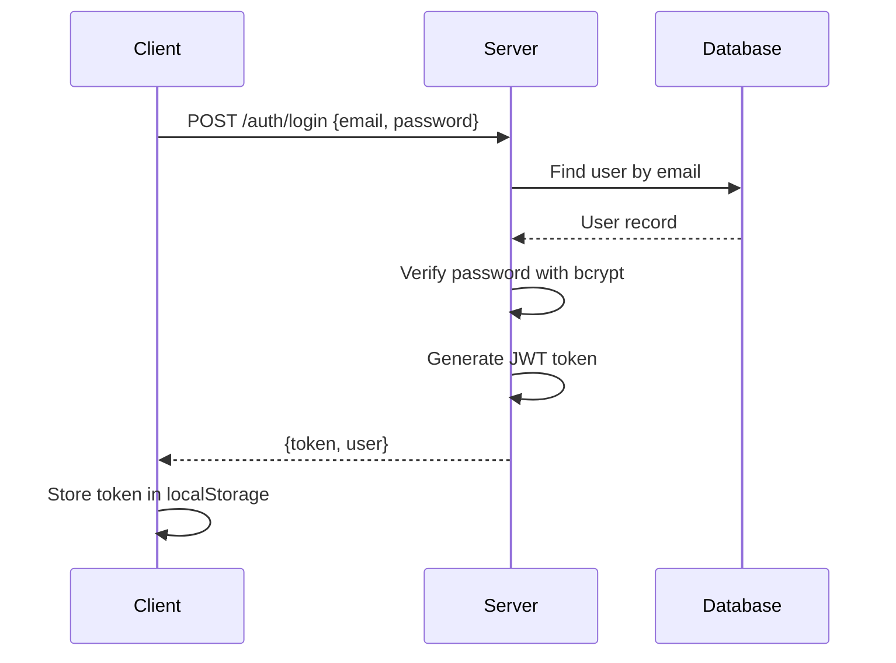
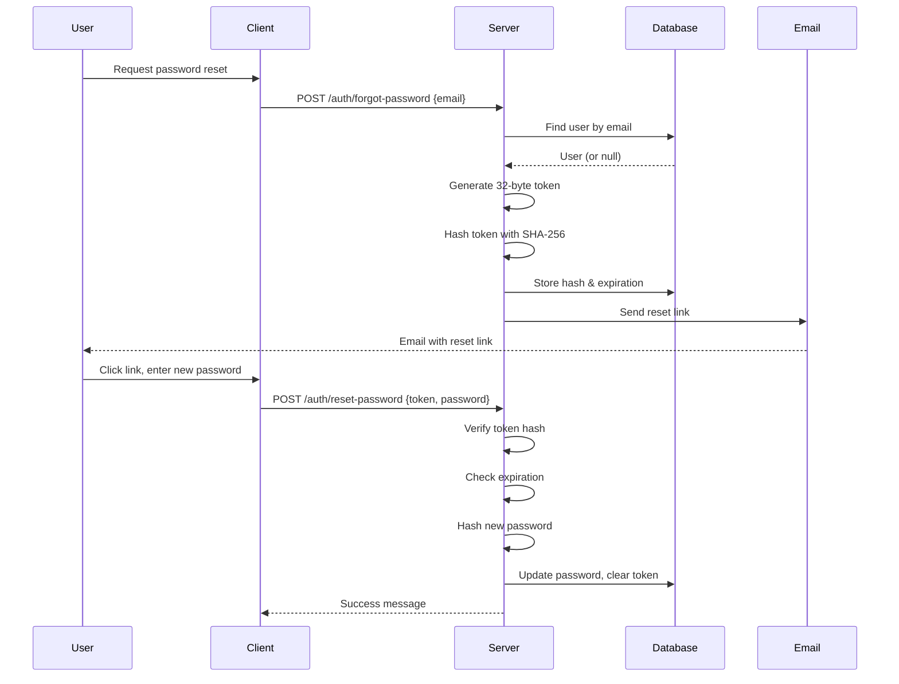

# Authentication and Permissions

**Last Updated:** October 14, 2026

---

## Table of Contents
1. [Overview](#overview)
2. [Authentication Mechanism](#authentication-mechanism)
3. [JWT Implementation](#jwt-implementation)
4. [Password Reset Flow](#password-reset-flow)
5. [Role-Based Authorization](#role-based-authorization)
6. [Permission Middleware](#permission-middleware)
7. [Security Best Practices](#security-best-practices)
8. [Troubleshooting](#troubleshooting)

---

## Overview

### Authentication Type
- **Method:** JWT (JSON Web Tokens)
- **Algorithm:** HS256
- **Token Expiration:** 7 days (configurable)
- **Token Storage:** Client-side localStorage
- **Password Hashing:** bcryptjs with 12 salt rounds

### Authorization Model
- **Type:** Role-Based Access Control (RBAC)
- **Roles:** admin, agent, user, property_manager, content_editor
- **Enforcement:** Middleware-based
- **Scope:** Route-level and resource-level

---

## Authentication Mechanism

### Login Flow



### Token Structure

**JWT Payload:**
```typescript
{
  id: string;      // User UUID
  email: string;   // User email
  role: string;    // User role
  iat: number;     // Issued at timestamp
  exp: number;     // Expiration timestamp
}
```

**Example:**
```json
{
  "id": "550e8400-e29b-41d4-a716-446655440000",
  "email": "admin@realestate.com",
  "role": "admin",
  "iat": 1697270400,
  "exp": 1697875200
}
```

### Token Lifecycle

1. **Generation:** On successful login, server signs JWT with `JWT_SECRET`
2. **Storage:** Client stores in localStorage (`admin_token` key)
3. **Transmission:** Client sends in `Authorization: Bearer <token>` header
4. **Verification:** Middleware verifies signature and expiration
5. **Expiration:** 7 days after issuance (configurable via `JWT_EXPIRES_IN`)
6. **Revocation:** Stateless - client simply discards token

---

## JWT Implementation

### Configuration

**Environment Variables:**
```bash
JWT_SECRET=your-super-secret-jwt-key-change-this-in-production
JWT_EXPIRES_IN=7d
```

**Security Notes:**
- `JWT_SECRET` must be strong random string in production
- Never commit `JWT_SECRET` to version control
- Use different secrets for development and production
- Minimum recommended length: 32 characters

### Token Generation

**Code Location:** `backend/src/controllers/authController.ts`

```typescript
const token = jwt.sign(
  { id: user.id, email: user.email, role: user.role.name },
  JWT_SECRET,
  { expiresIn: JWT_EXPIRES_IN } as jwt.SignOptions
);
```

### Token Verification

**Code Location:** `backend/src/middleware/auth.ts`

```typescript
export const requireAuth = (req: Request, res: Response, next: NextFunction) => {
  const authHeader = req.headers.authorization;

  if (!authHeader || !authHeader.startsWith('Bearer ')) {
    return res.status(401).json({
      success: false,
      message: 'Authentication required. Please provide a valid token.',
    });
  }

  const token = authHeader.replace('Bearer ', '').trim();

  if (!token) {
    return res.status(401).json({
      success: false,
      message: 'Authentication token is missing.',
    });
  }

  try {
    const decoded = jwt.verify(token, JWT_SECRET) as { id: string; role: string; email: string };
    req.user = { id: decoded.id, role: decoded.role };
    return next();
  } catch (err) {
    return res.status(401).json({
      success: false,
      message: 'Invalid or expired token. Please log in again.',
    });
  }
};
```

### Client-Side Token Management

**Code Location:** `frontend/src/context/AuthContext.tsx`

**Storage:**
```typescript
const TOKEN_KEY = 'admin_token';

// Save token
localStorage.setItem(TOKEN_KEY, token);

// Retrieve token
const token = localStorage.getItem(TOKEN_KEY);

// Remove token (logout)
localStorage.removeItem(TOKEN_KEY);
```

**Session Restoration:**
```typescript
useEffect(() => {
  const storedToken = localStorage.getItem(TOKEN_KEY);
  if (!storedToken) {
    setIsLoading(false);
    return;
  }

  setToken(storedToken);
  fetch(`${API_BASE}/auth/me`, {
    headers: { Authorization: `Bearer ${storedToken}` },
  })
    .then((res) => {
      if (!res.ok) throw new Error('Session expired');
      return res.json();
    })
    .then((body) => {
      setUser(body.data);
    })
    .catch(() => {
      localStorage.removeItem(TOKEN_KEY);
      setToken(null);
      setUser(null);
    })
    .finally(() => setIsLoading(false));
}, []);
```

---

## Password Reset Flow

### Overview

**Flow Type:** Email-based with one-time tokens  
**Token Expiration:** 30 minutes  
**Token Type:** Single-use  
**Token Security:** SHA-256 hashed before storage

### Configuration Requirements

**Environment Variables:**
```bash
FRONTEND_URL=http://localhost:3000
SMTP_HOST=smtp.gmail.com
SMTP_PORT=587
SMTP_SECURE=false
SMTP_USER=your-email@gmail.com
SMTP_PASS=your-app-password
SMTP_FROM=noreply@yourdomain.com
```

**SMTP Configuration:**
- For Gmail: Use app-specific password
- For STARTTLS: Port 587, SMTP_SECURE=false
- For implicit TLS: Port 465, SMTP_SECURE=true
- SMTP_FROM must be verified sender address

### Reset Flow Diagram



### Step 1: Request Reset

**Endpoint:** `POST /auth/forgot-password`

**Request:**
```json
{
  "email": "user@example.com"
}
```

**Validation:**
- Email format validation (regex)
- Email length validation (max 254 characters)
- SMTP configuration check

**Response (Success):**
```json
{
  "success": true,
  "message": "If an account exists for that email, password reset instructions will be sent."
}
```

**Response (SMTP Not Configured):**
```json
{
  "success": false,
  "message": "Password reset is temporarily unavailable. Please contact an administrator."
}
```

**Security Features:**
- Generic message regardless of whether email exists (prevents enumeration)
- Always replaces existing token (prevents stale links)
- Token delivery failure rolls back token storage

### Step 2: Send Email

**Code Location:** `backend/src/lib/passwordResetEmail.ts`

**Email Template:**
```
Subject: Reset your Ingata account password

Use the link below to reset your password. It expires in 30 minutes and can only be used once.

[Reset Password Link]

If you did not request this, you can ignore this email.
```

**Reset Link Format:**
```
{FRONTEND_URL}/portal/reset-password?token={raw_token}
```

**Example:**
```
http://localhost:3000/portal/reset-password?token=a1b2c3d4e5f6...
```

### Step 3: Reset Password

**Endpoint:** `POST /auth/reset-password`

**Request:**
```json
{
  "token": "64-character-hex-token",
  "password": "newpassword123"
}
```

**Validation:**
- Token format: 64 hex characters
- Password length: 8-128 characters
- Token expiration check
- Token hash verification

**Response (Success):**
```json
{
  "success": true,
  "message": "Password reset successfully. You can now sign in."
}
```

**Response (Errors):**
```json
{
  "success": false,
  "message": "This password reset link is invalid or expired."
}
```

### Security Features

1. **Token Hashing:**
   - Raw token never stored in database
   - SHA-256 hash stored instead
   - Prevents database token theft

2. **Single-Use:**
   - Token cleared after successful reset
   - Cannot be reused

3. **Expiration:**
   - 30-minute validity window
   - Calculated from token generation time

4. **Email Enumeration Prevention:**
   - Generic success message
   - Doesn't reveal if email exists

5. **Token Replacement:**
   - Always generates fresh token on repeat requests
   - Prevents stale link issues

6. **Delivery Failure Handling:**
   - Rolls back token storage if email fails
   - Prevents dangling tokens

---

## Role-Based Authorization

### User Roles

| Role | Description | Access Level |
|------|-------------|-------------|
| admin | Full system access | All endpoints |
| agent | Manage assigned properties | Agent dashboard, assigned properties |
| property_manager | Property oversight | Property manager dashboard, managed properties |
| content_editor | Content management | Content editor dashboard, CMS |
| user | Public access | Public endpoints, profile management |

### Role Creation

**Seeded Roles:** `backend/src/seed.ts`

```typescript
const roles = [
  { name: 'admin', description: 'Administrator with full access' },
  { name: 'agent', description: 'Real estate agent' },
  { name: 'user', description: 'Regular user' },
];
```

**Additional Roles:**
- `property_manager` - Added via database migration
- `content_editor` - May need manual creation

**Role Normalization:**
- Migration 20261007000002 normalized role names to lowercase
- Prevents case-sensitivity issues
- Enforces unique constraint on normalized names

### Authorization Middleware

**Code Location:** `backend/src/middleware/authorize.ts`

```typescript
export const authorize = (...allowedRoles: string[]) => {
  return (req: Request, res: Response, next: NextFunction) => {
    const user = req.user as { role?: string } | undefined;

    if (!user || !user.role) {
      return res.status(401).json({
        success: false,
        message: 'User not authenticated',
      });
    }

    // Case-insensitive role comparison
    if (!allowedRoles.map(r => r.toLowerCase()).includes(user.role.toLowerCase())) {
      return res.status(403).json({
        success: false,
        message: 'Forbidden: insufficient permissions',
      });
    }

    return next();
  };
};
```

**Usage:**
```typescript
router.get('/admin/dashboard', requireAuth, authorize('admin'), getDashboard);
router.get('/agent-dashboard/my-properties', requireAuth, authorize('agent'), getAgentProperties);
```

### Route-Level Authorization

**Admin Routes:** `backend/src/routes/adminRoutes.ts`

```typescript
// Apply authentication + admin role check to ALL admin routes
router.use(requireAuth, authorize('admin'));

router.get('/dashboard', getDashboard);
router.get('/users', getUsers);
router.post('/users', createUser);
// ... all admin routes
```

**Agent Dashboard Routes:** `backend/src/routes/agentDashboardRoutes.ts`

```typescript
router.use(requireAuth, authorize('agent'));

router.get('/my-properties', getAgentProperties);
router.patch('/my-properties/:id', updateAgentProperty);
// ... agent routes
```

**Property Manager Routes:** `backend/src/routes/propertyManagerRoutes.ts`

```typescript
router.use(requireAuth, authorize('property_manager'));

router.get('/', getManagedProperties);
router.post('/', createManagedProperty);
// ... PM routes
```

**Content Editor Routes:** `backend/src/routes/contentEditorRoutes.ts`

```typescript
router.use(requireAuth, authorize('content_editor'));

router.get('/articles', getEditorArticles);
router.post('/articles', createEditorArticle);
// ... content editor routes
```

---

## Permission Middleware

### Property Manager Ownership

**Purpose:** Ensure property managers can only access properties they manage (admin bypass)

**Code Location:** `backend/src/middleware/propertyManagerOwnership.ts`

#### Property Ownership Check

```typescript
export const requireOwnedManagerProperty: RequestHandler = async (req, res, next) => {
  // Admin bypass
  if (isAdmin(req.user?.role)) return next();
  
  // Must be property manager
  if (!isManager(req.user?.role) || !req.user?.id) {
    return res.status(403).json({ success: false, message: 'Forbidden: insufficient permissions.' });
  }
  
  try {
    const property = await AppDataSource.getRepository(Property).findOne({
      where: { 
        id: String(req.params.id), 
        propertyManagerId: req.user.id 
      },
      select: { id: true },
    });
    return property ? next() : res.status(404).json({ success: false, message: 'Resource not found.' });
  } catch (error) {
    return next(error);
  }
};
```

**Usage:**
```typescript
router.patch('/:id', requireOwnedManagerProperty, updateManagedProperty);
router.delete('/:id', requireOwnedManagerProperty, deleteManagedProperty);
```

#### Inquiry Ownership Check

```typescript
export const requireOwnedManagerInquiry: RequestHandler = async (req, res, next) => {
  if (isAdmin(req.user?.role)) return next();
  if (!isManager(req.user?.role) || !req.user?.id) {
    return res.status(403).json({ success: false, message: 'Forbidden: insufficient permissions.' });
  }
  
  try {
    const inquiry = await AppDataSource.getRepository(Inquiry).createQueryBuilder('inquiry')
      .innerJoin('inquiry.property', 'property')
      .where('inquiry.id = :id', { id: String(req.params.id) })
      .andWhere('property.propertyManagerId = :propertyManagerId', { propertyManagerId: req.user.id })
      .select(['inquiry.id'])
      .getOne();
    return inquiry ? next() : res.status(404).json({ success: false, message: 'Resource not found.' });
  } catch (error) {
    return next(error);
  }
};
```

#### Viewing Ownership Check

```typescript
export const requireOwnedManagerViewing: RequestHandler = async (req, res, next) => {
  if (isAdmin(req.user?.role)) return next();
  if (!isManager(req.user?.role) || !req.user?.id) {
    return res.status(403).json({ success: false, message: 'Forbidden: insufficient permissions.' });
  }
  
  try {
    const viewing = await AppDataSource.getRepository(ViewingRequest).createQueryBuilder('viewing')
      .innerJoin('viewing.property', 'property')
      .where('viewing.id = :id', { id: String(req.params.id) })
      .andWhere('property.propertyManagerId = :propertyManagerId', { propertyManagerId: req.user.id })
      .select(['viewing.id'])
      .getOne();
    return viewing ? next() : res.status(404).json({ success: false, message: 'Resource not found.' });
  } catch (error) {
    return next(error);
  }
};
```

### Auto-Assignment Middleware

**Purpose:** Automatically assign property manager ID on creation

```typescript
export const assignPropertyManager: RequestHandler = (req, res, next) => {
  if (isAdmin(req.user?.role)) return next();
  if (!isManager(req.user?.role) || !req.user?.id) {
    return res.status(401).json({ success: false, message: 'Property manager authentication is required.' });
  }
  req.body = { ...req.body, propertyManagerId: req.user.id };
  return next();
};
```

**Usage:**
```typescript
router.post('/', assignPropertyManager, createManagedProperty);
```

---

## Security Best Practices

### Password Security

**Hashing:**
```typescript
const passwordHash = await bcrypt.hash(password, 12);
```

- Salt rounds: 12 (recommended)
- Never store plain text passwords
- Use bcryptjs (not bcrypt) for JavaScript

**Validation:**
```typescript
const passwordValid = await bcrypt.compare(inputPassword, storedHash);
```

### Token Security

**Secret Key:**
- Use strong random string (32+ characters)
- Store in environment variable
- Rotate periodically in production
- Never commit to version control

**Transmission:**
- Always use HTTPS in production
- Include in Authorization header
- Never in URL parameters or body

**Expiration:**
- Default: 7 days
- Shorter for sensitive operations (optional)
- Configurable via `JWT_EXPIRES_IN`

### Email Security

**SMTP Configuration:**
- Use app-specific passwords for Gmail
- Use TLS/SSL for email transmission
- Verify sender email address
- Never log email credentials

**Reset Tokens:**
- Single-use only
- Short expiration (30 minutes)
- Hash before storage
- Clear after use

### Authorization Security

**Role Comparison:**
- Case-insensitive comparison
- Prevents case-sensitivity bypass attempts
- Normalized role names in database

**Ownership Checks:**
- Enforce at database level
- Query-based verification
- Admin bypass for operations

**Input Validation:**
- Validate all inputs
- Type checking
- Length limits
- Format validation (email, etc.)

### Common Security Pitfalls

**Avoid:**
1. Hardcoding secrets in code
2. Committing `.env` files
3. Using weak JWT secrets
4. Storing tokens in cookies without httpOnly flag
5. Sending tokens in URL parameters
6. Logging sensitive data
7. Exposing error details to clients

**Implement:**
1. HTTPS in production
2. CORS configuration
3. Rate limiting (TODO)
4. CSRF protection (TODO)
5. Input sanitization
6. SQL injection prevention (TypeORM handles this)
7. XSS prevention (React handles most)

---

## Troubleshooting

### Authentication Issues

#### Token Not Working

**Symptoms:** 401 Unauthorized errors

**Solutions:**
1. Verify `JWT_SECRET` is set in backend/.env
2. Check token format: `Authorization: Bearer <token>`
3. Verify token not expired
4. Restart backend after changing .env
5. Check browser console for exact error

#### Password Reset Not Sending

**Symptoms:** 503 Service Unavailable

**Solutions:**
1. Verify SMTP configuration in backend/.env
2. Check SMTP credentials are correct
3. Verify SMTP_FROM is verified email
4. Test SMTP with external tool (e.g., smtpjs.com)
5. Check email spam folder
6. Verify `FRONTEND_URL` is correct

#### Password Reset Link Invalid

**Symptoms:** 400 Bad Request - "This password reset link is invalid or expired"

**Solutions:**
1. Token may have expired (30-minute window)
2. Token may have been used already (single-use)
3. Token may be truncated in URL
4. Check token format (64 hex characters)
5. Request new reset link

### Authorization Issues

#### Role Not Recognized

**Symptoms:** 403 Forbidden - "insufficient permissions"

**Solutions:**
1. Verify user role in database
2. Check role name case (normalized to lowercase)
3. Verify middleware uses correct role name
4. Check if role exists in roles table
5. Run seed script to ensure roles exist

#### Property Manager Access Denied

**Symptoms:** 403 Forbidden or 404 Not Found

**Solutions:**
1. Verify property_manager_id is set on property
2. Check user role is property_manager
3. Verify user ID matches property_manager_id
4. Admin users should bypass ownership checks
5. Check middleware implementation

### Development vs Production

**Development:**
- Can use weaker secrets for testing
- SMTP may be optional
- Debug logging enabled

**Production:**
- Must use strong secrets
- SMTP required for password reset
- Debug logging disabled
- HTTPS required
- CORS configured for specific origins

---

## Security Checklist

### Before Production Deployment

- [ ] Change `JWT_SECRET` to strong random string
- [ ] Configure production SMTP settings
- [ ] Enable HTTPS
- [ ] Configure CORS for production domain
- [ ] Disable debug logging
- [ ] Set `NODE_ENV=production`
- [ ] Verify all roles are seeded correctly
- [ ] Test password reset flow end-to-end
- [ ] Test role-based authorization
- [ ] Review and rotate any exposed secrets
- [ ] Enable rate limiting (when implemented)
- [ ] Enable CSRF protection (when implemented)
- [ ] Set up error tracking (Sentry)
- [ ] Configure security headers (Helmet.js)
- [ ] Enable HTTP Strict Transport Security (HSTS)
- [ ] Review and test all authentication flows
