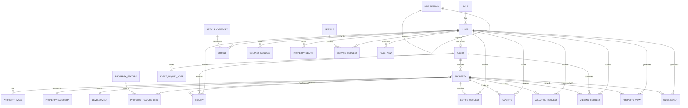

# Database Schema Documentation

**Last Updated:** October 19, 2026  
**Database:** PostgreSQL (Render)  
**ORM:** TypeORM 1.1.1  
**Migrations:** 9

---

## Table of Contents
1. [Overview](#overview)
2. [Entity Relationships](#entity-relationships)
3. [Authentication & Users](#authentication--users)
4. [Property Management](#property-management)
5. [Agents](#agents)
6. [Content Management](#content-management)
7. [User Interactions](#user-interactions)
8. [Analytics](#analytics)
9. [Indexes](#indexes)
10. [Migration History](#migration-history)

---

## Overview

### Database Statistics

- **Total Tables:** 28
- **Total Migrations:** 9
- **Primary Keys:** All text-based (UUID) except roles (serial)
- **Foreign Keys:** 32 relationships
- **Indexes:** 20+ performance indexes

### Naming Conventions

- **Tables:** snake_case (e.g., `property_images`)
- **Columns:** snake_case (e.g., `created_at`)
- **Entities:** PascalCase (e.g., `PropertyImage`)
- **Foreign Keys:** `{table}_id` (e.g., `user_id`)

### Data Types

| Type | Usage | Example |
|------|-------|---------|
| text | Strings, IDs | `id`, `name`, `email` |
| integer | Numbers, IDs | `role_id`, `bedrooms` |
| numeric | Decimal numbers | `price`, `size` |
| double precision | Floating point | `latitude`, `longitude` |
| boolean | True/false | `is_active`, `is_featured` |
| timestamp | Date/time | `created_at`, `listed_at` |
| text[] | Array of strings | `amenities` |
| jsonb | JSON data | `images` in listing_requests |

---

## Entity Relationships

### ER Diagram



---

## Authentication & Users

### roles

**Purpose:** Define user permission levels

| Column | Type | Constraints | Description |
|--------|------|-------------|-------------|
| id | integer | PRIMARY KEY, AUTO INCREMENT | Role ID |
| name | text | UNIQUE, NOT NULL | Role name (admin, agent, user, property_manager, content_editor) |
| description | text | NULLABLE | Role description |

**Seeded Roles:**
- admin - Administrator with full access
- agent - Real estate agent
- user - Regular public user
- property_manager - Property oversight
- content_editor - Content management

**Relationships:**
- One-to-many with users

### users

**Purpose:** User accounts and authentication

| Column | Type | Constraints | Description |
|--------|------|-------------|-------------|
| id | text | PRIMARY KEY | User UUID |
| name | text | NULLABLE | User display name |
| email | text | UNIQUE, NOT NULL | User email |
| phone | text | NULLABLE | User phone number |
| password_hash | text | NOT NULL | Bcrypt hashed password |
| role_id | integer | NOT NULL, FK → roles.id | User role |
| is_active | boolean | DEFAULT true | Account status |
| created_at | timestamp | NOT NULL, DEFAULT now() | Account creation date |
| updated_at | timestamp | NOT NULL, DEFAULT now() | Last update date |
| last_login_at | timestamp | NULLABLE | Last login timestamp |
| can_upload_property_media | boolean | DEFAULT false | Media upload permission |
| password_reset_token_hash | text | NULLABLE | Hashed reset token |
| password_reset_expires_at | timestamp | NULLABLE | Reset token expiration |

**Relationships:**
- Many-to-one with roles
- One-to-one with agents
- One-to-many with articles, contact_messages, favorites, inquiries, listing_requests, property_searches, service_requests, valuation_requests, viewing_requests, page_views, property_views, click_events

**Indexes:**
- email (unique)

---

## Property Management

### properties

**Purpose:** Property listings

| Column | Type | Constraints | Description |
|--------|------|-------------|-------------|
| id | text | PRIMARY KEY | Property UUID |
| property_id | text | UNIQUE, NULLABLE | External property ID |
| title | text | NOT NULL | Property title |
| slug | text | UNIQUE, NOT NULL | URL-friendly identifier |
| description | text | NULLABLE | Property description |
| category_id | text | FK → property_categories.id | Property category |
| agent_id | text | FK → agents.id | Assigned agent |
| property_manager_id | text | FK → users.id | Property manager |
| development_id | text | FK → developments.id | Development |
| property_type | text | DEFAULT 'RESIDENTIAL' | Property type (RESIDENTIAL, COMMERCIAL, etc.) |
| transaction_type | text | DEFAULT 'SALE' | Transaction type (SALE, RENT, LEASE) |
| price | numeric | NULLABLE | Property price |
| currency | text | NULLABLE | Currency code |
| location | text | NULLABLE | General location |
| district | text | NULLABLE | District/region |
| sector | text | NULLABLE | Sector/area |
| address | text | NULLABLE | Full address |
| latitude | double precision | NULLABLE | GPS latitude |
| longitude | double precision | NULLABLE | GPS longitude |
| size | numeric | NULLABLE | Property size |
| size_unit | text | NULLABLE | Size unit (sqm, sqft) |
| bedrooms | integer | NULLABLE | Number of bedrooms |
| bathrooms | integer | NULLABLE | Number of bathrooms |
| status | text | DEFAULT 'AVAILABLE' | Availability status |
| publication_status | text | DEFAULT 'PUBLISHED' | Publication status |
| is_featured | boolean | DEFAULT false | Featured property flag |
| is_new_development | boolean | DEFAULT false | New development flag |
| listed_at | timestamp | NULLABLE | Listing date |
| created_at | timestamp | NOT NULL, DEFAULT now() | Creation date |
| updated_at | timestamp | NOT NULL, DEFAULT now() | Last update |
| furnishing_status | text | NULLABLE | Furnishing status |
| amenities | text[] | DEFAULT '{}' | Array of amenities |
| area | text | NULLABLE | Area description |
| location_description | text | NULLABLE | Detailed location |
| nearby_landmarks | text | NULLABLE | Nearby landmarks |
| neighborhood | text | NULLABLE | Neighborhood name |
| parking | integer | NULLABLE | Parking spaces |

**Relationships:**
- Many-to-one with agent, property_manager, category, development
- One-to-many with property_images, property_features, favorites, inquiries, listing_requests, valuation_requests, viewing_requests, property_views, click_events

**Indexes:**
- status
- publication_status
- agent_id
- category_id
- slug (unique)

### property_categories

**Purpose:** Property categorization

| Column | Type | Constraints | Description |
|--------|------|-------------|-------------|
| id | text | PRIMARY KEY | Category UUID |
| name | text | UNIQUE, NOT NULL | Category name |
| slug | text | UNIQUE, NOT NULL | URL-friendly identifier |
| description | text | NULLABLE | Category description |
| is_active | boolean | DEFAULT true | Active status |
| created_at | timestamp | NOT NULL, DEFAULT now() | Creation date |
| updated_at | timestamp | NOT NULL, DEFAULT now() | Last update |
| image_url | text | NULLABLE | Category image |

**Relationships:**
- One-to-many with properties

### property_features

**Purpose:** Available property features

| Column | Type | Constraints | Description |
|--------|------|-------------|-------------|
| id | text | PRIMARY KEY | Feature UUID |
| name | text | UNIQUE, NOT NULL | Feature name |
| slug | text | UNIQUE, NOT NULL | URL-friendly identifier |
| created_at | timestamp | NOT NULL, DEFAULT now() | Creation date |

**Relationships:**
- Many-to-many with properties via property_feature_links

### property_feature_links

**Purpose:** Junction table for property-features relationship

| Column | Type | Constraints | Description |
|--------|------|-------------|-------------|
| property_id | text | FK → properties.id, NOT NULL | Property ID |
| feature_id | text | FK → property_features.id, NOT NULL | Feature ID |

**Primary Key:** (property_id, feature_id)

**Relationships:**
- Many-to-one with properties (CASCADE delete)
- Many-to-one with property_features (CASCADE delete)

### property_images

**Purpose:** Property media (images/videos)

| Column | Type | Constraints | Description |
|--------|------|-------------|-------------|
| id | text | PRIMARY KEY | Image UUID |
| property_id | text | FK → properties.id, NOT NULL | Property ID |
| image_url | text | NOT NULL | Image/video URL |
| alt_text | text | NULLABLE | Alt text for accessibility |
| display_order | integer | DEFAULT 0 | Display order |
| is_primary | boolean | DEFAULT false | Primary image flag |
| created_at | timestamp | NOT NULL, DEFAULT now() | Upload date |
| media_type | text | DEFAULT 'IMAGE' | MEDIA type (IMAGE, VIDEO) |

**Relationships:**
- Many-to-one with properties (CASCADE delete)

### developments

**Purpose:** Real estate developments

| Column | Type | Constraints | Description |
|--------|------|-------------|-------------|
| id | text | PRIMARY KEY | Development UUID |
| name | text | NOT NULL | Development name |
| slug | text | UNIQUE, NOT NULL | URL-friendly identifier |
| description | text | NULLABLE | Development description |
| location | text | NULLABLE | Development location |
| developer_name | text | NULLABLE | Developer name |
| status | text | NULLABLE | Development status |
| completion_date | timestamp | NULLABLE | Expected completion |
| image_url | text | NULLABLE | Development image |
| created_at | timestamp | NOT NULL, DEFAULT now() | Creation date |
| updated_at | timestamp | NOT NULL, DEFAULT now() | Last update |

**Relationships:**
- One-to-many with properties

---

## Agents

### agents

**Purpose:** Agent profiles

| Column | Type | Constraints | Description |
|--------|------|-------------|-------------|
| id | text | PRIMARY KEY | Agent UUID |
| user_id | text | UNIQUE, FK → users.id, NOT NULL | Associated user |
| name | text | NOT NULL | Agent name |
| slug | text | UNIQUE, NOT NULL | URL-friendly identifier |
| email | text | NULLABLE | Agent email |
| phone | text | NULLABLE | Agent phone |
| profile_image | text | NULLABLE | Profile image URL |
| bio | text | NULLABLE | Agent biography |
| specialization | text | NULLABLE | Agent specialization |
| license_number | text | NULLABLE | License number |
| years_experience | integer | NULLABLE | Years of experience |
| is_active | boolean | DEFAULT true | Active status |
| created_at | timestamp | NOT NULL, DEFAULT now() | Creation date |
| updated_at | timestamp | NOT NULL, DEFAULT now() | Last update |

**Relationships:**
- Many-to-one with users (CASCADE delete)
- One-to-many with properties, inquiries, viewing_requests

### agent_inquiry_notes

**Purpose:** Agent notes on inquiries

| Column | Type | Constraints | Description |
|--------|------|-------------|-------------|
| id | text | PRIMARY KEY | Note UUID |
| agent_id | text | FK → agents.id, NOT NULL | Agent ID |
| inquiry_id | text | FK → inquiries.id, NOT NULL | Inquiry ID |
| notes | text | DEFAULT '' | Note content |
| next_follow_up_date | timestamp | NULLABLE | Next follow-up date |
| created_at | timestamp | NOT NULL, DEFAULT now() | Creation date |
| updated_at | timestamp | NOT NULL, DEFAULT now() | Last update |

**Unique Constraint:** (agent_id, inquiry_id)

---

## Content Management

### articles

**Purpose:** Blog articles/insights

| Column | Type | Constraints | Description |
|--------|------|-------------|-------------|
| id | text | PRIMARY KEY | Article UUID |
| title | text | NOT NULL | Article title |
| slug | text | UNIQUE, NOT NULL | URL-friendly identifier |
| excerpt | text | NULLABLE | Article excerpt |
| content | text | NOT NULL | Article content |
| featured_image | text | NULLABLE | Featured image URL |
| category_id | text | FK → article_categories.id | Article category |
| author_id | text | FK → users.id | Author |
| publication_status | text | DEFAULT 'DRAFT' | Publication status |
| published_at | timestamp | NULLABLE | Publication date |
| created_at | timestamp | NOT NULL, DEFAULT now() | Creation date |
| updated_at | timestamp | NOT NULL, DEFAULT now() | Last update |

**Relationships:**
- Many-to-one with users, article_categories

### article_categories

**Purpose:** Article categorization

| Column | Type | Constraints | Description |
|--------|------|-------------|-------------|
| id | text | PRIMARY KEY | Category UUID |
| name | text | UNIQUE, NOT NULL | Category name |
| slug | text | UNIQUE, NOT NULL | URL-friendly identifier |
| description | text | NULLABLE | Category description |
| is_active | boolean | DEFAULT true | Active status |
| created_at | timestamp | NOT NULL, DEFAULT now() | Creation date |
| updated_at | timestamp | NOT NULL, DEFAULT now() | Last update |
| image_url | text | NULLABLE | Category image |

**Relationships:**
- One-to-many with articles

### site_pages

**Purpose:** Static site pages

| Column | Type | Constraints | Description |
|--------|------|-------------|-------------|
| id | text | PRIMARY KEY | Page UUID |
| title | text | NOT NULL | Page title |
| slug | text | UNIQUE, NOT NULL | URL-friendly identifier |
| content | text | NULLABLE | Page content |
| page_type | text | NULLABLE | Page type |
| meta_title | text | NULLABLE | SEO meta title |
| meta_description | text | NULLABLE | SEO meta description |
| is_published | boolean | DEFAULT true | Published status |
| created_at | timestamp | NOT NULL, DEFAULT now() | Creation date |
| updated_at | timestamp | NOT NULL, DEFAULT now() | Last update |

### site_settings

**Purpose:** Site-wide configuration (singleton)

| Column | Type | Constraints | Description |
|--------|------|-------------|-------------|
| id | text | PRIMARY KEY | Settings ID (usually 'default') |
| site_name | text | NULLABLE | Site name |
| logo_url | text | NULLABLE | Logo URL |
| favicon_url | text | NULLABLE | Favicon URL |
| email | text | NULLABLE | Contact email |
| phone | text | NULLABLE | Contact phone |
| address | text | NULLABLE | Physical address |
| facebook_url | text | NULLABLE | Facebook URL |
| instagram_url | text | NULLABLE | Instagram URL |
| x_url | text | NULLABLE | X (Twitter) URL |
| linkedin_url | text | NULLABLE | LinkedIn URL |
| default_currency | text | NULLABLE | Default currency |
| created_at | timestamp | NOT NULL, DEFAULT now() | Creation date |
| updated_at | timestamp | NOT NULL, DEFAULT now() | Last update |
| about_cta_link | text | NULLABLE | About CTA link |
| about_cta_text | text | NULLABLE | About CTA text |
| about_description | text | NULLABLE | About description |
| about_image_url | text | NULLABLE | About image |
| about_title | text | NULLABLE | About title |
| featured_section_title | text | NULLABLE | Featured section title |
| hero_cta_link | text | NULLABLE | Hero CTA link |
| hero_cta_text | text | NULLABLE | Hero CTA text |
| hero_image_url | text | NULLABLE | Hero image |
| hero_subtitle | text | NULLABLE | Hero subtitle |
| hero_title | text | NULLABLE | Hero title |
| services_description | text | NULLABLE | Services description |
| services_title | text | NULLABLE | Services title |
| show_about_section | boolean | DEFAULT false | Show about section |
| show_featured_section | boolean | DEFAULT false | Show featured section |
| show_services_section | boolean | DEFAULT false | Show services section |
| whatsapp | text | NULLABLE | WhatsApp number |
| analytics_retention_days | integer | DEFAULT 365 | Analytics data retention |

### services

**Purpose:** Service offerings

| Column | Type | Constraints | Description |
|--------|------|-------------|-------------|
| id | text | PRIMARY KEY | Service UUID |
| name | text | NOT NULL | Service name |
| slug | text | UNIQUE, NOT NULL | URL-friendly identifier |
| short_description | text | NULLABLE | Short description |
| description | text | NULLABLE | Full description |
| image_url | text | NULLABLE | Service image |
| is_active | boolean | DEFAULT true | Active status |
| display_order | integer | DEFAULT 0 | Display order |
| created_at | timestamp | NOT NULL, DEFAULT now() | Creation date |
| updated_at | timestamp | NOT NULL, DEFAULT now() | Last update |

**Relationships:**
- One-to-many with service_requests

### testimonials

**Purpose:** Customer testimonials

| Column | Type | Constraints | Description |
|--------|------|-------------|-------------|
| id | text | PRIMARY KEY | Testimonial UUID |
| name | text | NOT NULL | Customer name |
| role | text | NULLABLE | Customer role |
| content | text | NOT NULL | Testimonial content |
| image_url | text | NULLABLE | Customer image |
| rating | integer | DEFAULT 5 | Rating (1-5) |
| is_featured | boolean | DEFAULT false | Featured testimonial |
| is_active | boolean | DEFAULT true | Active status |
| created_at | timestamp | NOT NULL, DEFAULT now() | Creation date |
| updated_at | timestamp | NOT NULL, DEFAULT now() | Last update |

### faqs

**Purpose:** Frequently asked questions

| Column | Type | Constraints | Description |
|--------|------|-------------|-------------|
| id | text | PRIMARY KEY | FAQ UUID |
| question | text | NOT NULL | Question text |
| answer | text | NOT NULL | Answer text |
| category | text | NULLABLE | FAQ category |
| display_order | integer | DEFAULT 0 | Display order |
| is_active | boolean | DEFAULT true | Active status |
| created_at | timestamp | NOT NULL, DEFAULT now() | Creation date |
| updated_at | timestamp | NOT NULL, DEFAULT now() | Last update |

---

## User Interactions

### inquiries

**Purpose:** Property inquiries

| Column | Type | Constraints | Description |
|--------|------|-------------|-------------|
| id | text | PRIMARY KEY | Inquiry UUID |
| property_id | text | FK → properties.id, NULLABLE | Property ID |
| agent_id | text | FK → agents.id, NULLABLE | Agent ID |
| user_id | text | FK → users.id, NULLABLE | User ID |
| name | text | NOT NULL | Inquirer name |
| email | text | NOT NULL | Inquirer email |
| phone | text | NULLABLE | Inquirer phone |
| message | text | NOT NULL | Inquiry message |
| status | text | DEFAULT 'NEW' | Inquiry status |
| created_at | timestamp | NOT NULL, DEFAULT now() | Creation date |
| updated_at | timestamp | NOT NULL, DEFAULT now() | Last update |

**Relationships:**
- Many-to-one with properties, agents, users

**Indexes:**
- status
- property_id

### viewing_requests

**Purpose:** Property viewing requests

| Column | Type | Constraints | Description |
|--------|------|-------------|-------------|
| id | text | PRIMARY KEY | Viewing UUID |
| property_id | text | FK → properties.id, NOT NULL | Property ID |
| user_id | text | FK → users.id, NULLABLE | User ID |
| agent_id | text | FK → agents.id, NULLABLE | Agent ID |
| name | text | NOT NULL | Requester name |
| email | text | NOT NULL | Requester email |
| phone | text | NULLABLE | Requester phone |
| preferred_date | timestamp | NULLABLE | Preferred viewing date |
| preferred_time | text | NULLABLE | Preferred time |
| message | text | NULLABLE | Additional message |
| status | text | DEFAULT 'PENDING' | Viewing status |
| created_at | timestamp | NOT NULL, DEFAULT now() | Creation date |
| updated_at | timestamp | NOT NULL, DEFAULT now() | Last update |

**Relationships:**
- Many-to-one with properties (CASCADE delete), agents, users

**Indexes:**
- status
- property_id

### listing_requests

**Purpose:** User-submitted property listings

| Column | Type | Constraints | Description |
|--------|------|-------------|-------------|
| id | text | PRIMARY KEY | Request UUID |
| property_id | text | FK → properties.id, NULLABLE | Created property ID |
| user_id | text | FK → users.id, NULLABLE | User ID |
| name | text | NOT NULL | Submitter name |
| email | text | NOT NULL | Submitter email |
| phone | text | NULLABLE | Submitter phone |
| property_type | text | DEFAULT 'RESIDENTIAL' | Property type |
| transaction_type | text | DEFAULT 'SALE' | Transaction type |
| location | text | NOT NULL | Property location |
| district | text | NULLABLE | District |
| sector | text | NULLABLE | Sector |
| property_size | numeric | NULLABLE | Property size |
| size_unit | text | NULLABLE | Size unit |
| bedrooms | integer | NULLABLE | Bedrooms |
| bathrooms | integer | NULLABLE | Bathrooms |
| description | text | NULLABLE | Description |
| price | numeric | NULLABLE | Asking price |
| images | jsonb | DEFAULT '[]'::jsonb | Array of image objects |
| status | text | DEFAULT 'SUBMITTED' | Request status |
| created_at | timestamp | NOT NULL, DEFAULT now() | Creation date |
| updated_at | timestamp | NOT NULL, DEFAULT now() | Last update |

**Relationships:**
- Many-to-one with properties, users

### valuation_requests

**Purpose:** Property valuation requests

| Column | Type | Constraints | Description |
|--------|------|-------------|-------------|
| id | text | PRIMARY KEY | Request UUID |
| property_id | text | FK → properties.id, NULLABLE | Property ID |
| user_id | text | FK → users.id, NULLABLE | User ID |
| name | text | NOT NULL | Requester name |
| email | text | NOT NULL | Requester email |
| phone | text | NULLABLE | Requester phone |
| property_type | text | DEFAULT 'RESIDENTIAL' | Property type |
| location | text | NOT NULL | Property location |
| property_size | numeric | NULLABLE | Property size |
| bedrooms | integer | NULLABLE | Bedrooms |
| bathrooms | integer | NULLABLE | Bathrooms |
| description | text | NULLABLE | Description |
| estimated_value | numeric | NULLABLE | Estimated value |
| status | text | DEFAULT 'NEW' | Request status |
| created_at | timestamp | NOT NULL, DEFAULT now() | Creation date |
| updated_at | timestamp | NOT NULL, DEFAULT now() | Last update |

**Relationships:**
- Many-to-one with properties, users

### property_searches

**Purpose:** Saved property searches

| Column | Type | Constraints | Description |
|--------|------|-------------|-------------|
| id | text | PRIMARY KEY | Search UUID |
| user_id | text | FK → users.id, NULLABLE | User ID |
| email | text | NULLABLE | Email for alerts |
| location | text | NULLABLE | Search location |
| property_type | text | NULLABLE | Property type |
| transaction_type | text | NULLABLE | Transaction type |
| min_price | numeric | NULLABLE | Minimum price |
| max_price | numeric | NULLABLE | Maximum price |
| min_bedrooms | integer | NULLABLE | Minimum bedrooms |
| max_bedrooms | integer | NULLABLE | Maximum bedrooms |
| min_bathrooms | integer | NULLABLE | Minimum bathrooms |
| max_bathrooms | integer | NULLABLE | Maximum bathrooms |
| min_size | numeric | NULLABLE | Minimum size |
| max_size | numeric | NULLABLE | Maximum size |
| size_unit | text | NULLABLE | Size unit |
| availability | text | NULLABLE | Availability |
| furnishing_status | text | NULLABLE | Furnishing status |
| features | text[] | DEFAULT '{}' | Desired features |
| created_at | timestamp | NOT NULL, DEFAULT now() | Creation date |
| updated_at | timestamp | NOT NULL, DEFAULT now() | Last update |

**Relationships:**
- Many-to-one with users (CASCADE delete)

**Indexes:**
- user_id

### favorites

**Purpose:** User favorite properties

| Column | Type | Constraints | Description |
|--------|------|-------------|-------------|
| id | text | PRIMARY KEY | Favorite UUID |
| user_id | text | FK → users.id, NOT NULL | User ID |
| property_id | text | FK → properties.id, NOT NULL | Property ID |
| created_at | timestamp | NOT NULL, DEFAULT now() | Creation date |

**Unique Constraint:** (user_id, property_id)

**Relationships:**
- Many-to-one with users (CASCADE delete), properties (CASCADE delete)

### contact_messages

**Purpose:** Contact form submissions

| Column | Type | Constraints | Description |
|--------|------|-------------|-------------|
| id | text | PRIMARY KEY | Message UUID |
| name | text | NOT NULL | Sender name |
| email | text | NOT NULL | Sender email |
| phone | text | NULLABLE | Sender phone |
| subject | text | NULLABLE | Message subject |
| message | text | NOT NULL | Message content |
| status | text | DEFAULT 'NEW' | Message status |
| created_at | timestamp | NOT NULL, DEFAULT now() | Creation date |
| updated_at | timestamp | NOT NULL, DEFAULT now() | Last update |
| user_id | text | FK → users.id, NULLABLE | User ID |

**Relationships:**
- Many-to-one with users

### service_requests

**Purpose:** Service inquiry requests

| Column | Type | Constraints | Description |
|--------|------|-------------|-------------|
| id | text | PRIMARY KEY | Request UUID |
| service_id | text | FK → services.id, NOT NULL | Service ID |
| user_id | text | FK → users.id, NULLABLE | User ID |
| name | text | NOT NULL | Requester name |
| email | text | NOT NULL | Requester email |
| phone | text | NULLABLE | Requester phone |
| message | text | NULLABLE | Message |
| status | text | DEFAULT 'NEW' | Request status |
| created_at | timestamp | NOT NULL, DEFAULT now() | Creation date |
| updated_at | timestamp | NOT NULL, DEFAULT now() | Last update |

**Relationships:**
- Many-to-one with services (CASCADE delete), users (CASCADE delete)

---

## Analytics

### page_views

**Purpose:** Page view tracking

| Column | Type | Constraints | Description |
|--------|------|-------------|-------------|
| id | text | PRIMARY KEY | View UUID |
| user_id | text | FK → users.id, NULLABLE | User ID |
| session_id | text | NULLABLE | Session ID |
| page_path | text | NOT NULL | Page path |
| page_title | text | NULLABLE | Page title |
| referrer | text | NULLABLE | Referrer URL |
| utm_source | text | NULLABLE | UTM source |
| utm_medium | text | NULLABLE | UTM medium |
| utm_campaign | text | NULLABLE | UTM campaign |
| utm_term | text | NULLABLE | UTM term |
| utm_content | text | NULLABLE | UTM content |
| device_type | text | NULLABLE | Device type |
| browser | text | NULLABLE | Browser |
| os | text | NULLABLE | Operating system |
| ip_address | text | NULLABLE | IP address |
| country | text | NULLABLE | Country |
| city | text | NULLABLE | City |
| created_at | timestamp | NOT NULL, DEFAULT now() | View timestamp |

**Relationships:**
- Many-to-one with users (SET NULL)

**Indexes:**
- user_id
- page_path
- created_at
- created_at (cleanup)

### property_views

**Purpose:** Property detail view tracking

| Column | Type | Constraints | Description |
|--------|------|-------------|-------------|
| id | text | PRIMARY KEY | View UUID |
| user_id | text | FK → users.id, NULLABLE | User ID |
| session_id | text | NULLABLE | Session ID |
| property_id | text | FK → properties.id, NOT NULL | Property ID |
| session_duration_seconds | text | NULLABLE | Session duration |
| referrer | text | NULLABLE | Referrer URL |
| device_type | text | NULLABLE | Device type |
| ip_address | text | NULLABLE | IP address |
| created_at | timestamp | NOT NULL, DEFAULT now() | View timestamp |

**Relationships:**
- Many-to-one with users (SET NULL), properties (CASCADE delete)

**Indexes:**
- user_id
- property_id
- created_at
- created_at (cleanup)

### click_events

**Purpose:** User interaction tracking

| Column | Type | Constraints | Description |
|--------|------|-------------|-------------|
| id | text | PRIMARY KEY | Event UUID |
| user_id | text | FK → users.id, NULLABLE | User ID |
| session_id | text | NULLABLE | Session ID |
| event_type | text | NOT NULL | Event type (CTA, PHONE, EMAIL, WHATSAPP, LINK, BUTTON) |
| property_id | text | FK → properties.id, NULLABLE | Property ID |
| element_id | text | NULLABLE | Element ID |
| element_text | text | NULLABLE | Element text |
| page_path | text | NOT NULL | Page path |
| destination_url | text | NULLABLE | Destination URL |
| device_type | text | NULLABLE | Device type |
| ip_address | text | NULLABLE | IP address |
| created_at | timestamp | NOT NULL, DEFAULT now() | Event timestamp |

**Relationships:**
- Many-to-one with users (SET NULL), properties (SET NULL)

**Indexes:**
- user_id
- event_type
- property_id
- created_at
- created_at (cleanup)

---

## Indexes

### Performance Indexes

**Properties:**
```sql
CREATE INDEX idx_properties_status ON properties(status);
CREATE INDEX idx_properties_publication_status ON properties(publication_status);
CREATE INDEX idx_properties_agent_id ON properties(agent_id);
CREATE INDEX idx_properties_category_id ON properties(category_id);
CREATE INDEX idx_properties_slug ON properties(slug);
```

**Inquiries:**
```sql
CREATE INDEX idx_inquiries_status ON inquiries(status);
CREATE INDEX idx_inquiries_property_id ON inquiries(property_id);
```

**Viewing Requests:**
```sql
CREATE INDEX idx_viewing_requests_status ON viewing_requests(status);
CREATE INDEX idx_viewing_requests_property_id ON viewing_requests(property_id);
```

**Property Searches:**
```sql
CREATE INDEX idx_property_searches_user_id ON property_searches(user_id);
```

**Analytics - Page Views:**
```sql
CREATE INDEX idx_page_views_user_id ON page_views(user_id);
CREATE INDEX idx_page_views_page_path ON page_views(page_path);
CREATE INDEX idx_page_views_created_at ON page_views(created_at);
CREATE INDEX idx_page_views_created_at_cleanup ON page_views(created_at);
```

**Analytics - Property Views:**
```sql
CREATE INDEX idx_property_views_user_id ON property_views(user_id);
CREATE INDEX idx_property_views_property_id ON property_views(property_id);
CREATE INDEX idx_property_views_created_at ON property_views(created_at);
CREATE INDEX idx_property_views_created_at_cleanup ON property_views(created_at);
```

**Analytics - Click Events:**
```sql
CREATE INDEX idx_click_events_user_id ON click_events(user_id);
CREATE INDEX idx_click_events_event_type ON click_events(event_type);
CREATE INDEX idx_click_events_property_id ON click_events(property_id);
CREATE INDEX idx_click_events_created_at ON click_events(created_at);
CREATE INDEX idx_click_events_created_at_cleanup ON click_events(created_at);
```

---

## Migration History

### Migration 1: 20261002000001-ResetDatabaseSchema

**Type:** Complete schema reset

**Changes:**
- Dropped all existing tables
- Created all 28 tables with initial schema
- Created initial indexes
- Set up foreign key constraints

**Tables Created:**
- roles, users, article_categories, agents, faqs, testimonials, site_settings, site_pages, services, property_categories, property_features, developments, articles, properties, property_images, property_feature_links, favorites, inquiries, listing_requests, valuation_requests, viewing_requests, property_searches, service_requests, contact_messages

**Note:** This migration cannot be rolled back automatically. Manual intervention required.

### Migration 2: 20261007000001-AddPasswordResetFields

**Type:** Schema addition

**Changes:**
- Added `password_reset_token_hash` to users (text, nullable)
- Added `password_reset_expires_at` to users (timestamp, nullable)

**Purpose:** Enable password reset functionality

### Migration 3: 20261007000002-DeduplicateRoleNames

**Type:** Data migration

**Changes:**
- Normalized role names to lowercase
- Merged duplicate role names
- Enforced unique constraint on normalized names

**Purpose:** Fix case sensitivity issues in role comparisons

### Migration 4: 20261008000001-AddAgentInquiryNotes

**Type:** Schema addition

**Changes:**
- Created `agent_inquiry_notes` table
- Added unique constraint on (agent_id, inquiry_id)

**Purpose:** Enable agents to add notes and follow-up dates to inquiries

### Migration 5: 20261008000002-AddPropertyManagerOwnership

**Type:** Schema addition

**Changes:**
- Added `property_manager_id` to properties (text, nullable, FK → users.id)

**Purpose:** Enable property manager assignment to properties

### Migration 6: 20261012000001-RenameInquiryMessageColumn

**Type:** Schema modification

**Changes:**
- Renamed `inquiries.message` column from `inquiry` to `message`

**Purpose:** Fix column naming inconsistency

**Note:** Verify entity alignment with this change

### Migration 7: 20261012000002-CreateAnalyticsTables

**Type:** Schema addition

**Changes:**
- Created `page_views` table
- Created `property_views` table
- Created `click_events` table
- Added indexes for analytics tables

**Purpose:** Enable custom analytics tracking

### Migration 8: 20261012000003-AddDataRetention

**Type:** Schema addition

**Changes:**
- Added `analytics_retention_days` to site_settings (integer, default 365)
- Added cleanup indexes for analytics tables

**Purpose:** Enable analytics data retention policy

**Note:** Cleanup job not yet implemented - requires scheduled task

### Migration 9: 20261018000001-InsertArticleCategories

**Type:** Data seeding

**Changes:**
- Inserted default article categories into article_categories table
- Categories include: Market News, Buying Tips, Selling Tips, Property Management, Investment

**Purpose:** Provide default article categories for content management

**Note:** Run with `npm run seed:article-categories` if manual seeding needed

---

## Schema Inconsistencies

### Known Issues

1. **Inquiry Message Column:** ✅ RESOLVED
   - Migration 20261012000001 renamed column from `inquiry` to `message`
   - Entity `Inquiry.ts` verified to use correct column name `message`
   - **Status:** ✅ Aligned (verified October 19, 2026)

2. **Property Manager Role:** ⚠️ NEEDS TESTING
   - Property manager role added to seed data
   - Verify all PM-related functionality works end-to-end
   - **Status:** Needs testing in production

3. **Content Editor Role:** ⚠️ NEEDS VERIFICATION
   - Content editor role may not be in seed data
   - Verify role exists in production database
   - **Status:** Needs verification

### Recommendations

1. **Audit Entity-Column Alignment:**
   - Compare all entities with actual database schema
   - Fix any naming inconsistencies
   - Update migrations if needed

2. **Add Missing Roles:**
   - Ensure all roles (property_manager, content_editor) are seeded
   - Verify role normalization is complete

3. **Implement Cleanup Job:**
   - Create scheduled task for analytics data cleanup
   - Use `analytics_retention_days` from site_settings
   - Delete old analytics data based on retention policy

---

## Database Maintenance

### Backup

**Manual Backup:**
```bash
pg_dump -h [host] -U [user] -d [database] > backup.sql
```

**Neon Backup:**
- Neon provides automated backups
- Use Neon console for point-in-time recovery

### Restore

**Manual Restore:**
```bash
psql -h [host] -U [user] -d [database] < backup.sql
```

### Performance Monitoring

**Check Slow Queries:**
```sql
SELECT query, mean_exec_time, calls
FROM pg_stat_statements
ORDER BY mean_exec_time DESC
LIMIT 10;
```

**Check Table Sizes:**
```sql
SELECT
  schemaname,
  tablename,
  pg_size_pretty(pg_total_relation_size(schemaname||'.'||tablename)) AS size
FROM pg_tables
WHERE schemaname = 'public'
ORDER BY pg_total_relation_size(schemaname||'.'||tablename) DESC;
```

### Data Cleanup

**Manual Analytics Cleanup:**
```sql
DELETE FROM page_views
WHERE created_at < NOW() - INTERVAL '365 days';

DELETE FROM property_views
WHERE created_at < NOW() - INTERVAL '365 days';

DELETE FROM click_events
WHERE created_at < NOW() - INTERVAL '365 days';
```

Replace `365 days` with value from `site_settings.analytics_retention_days`.
